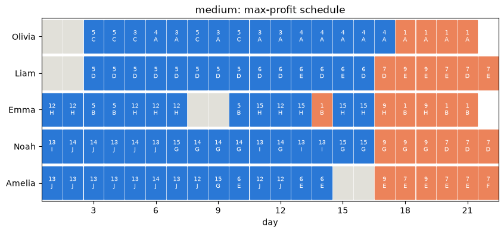

# CompuOpti: multi-objective staff scheduling

Decision Modelling project, CentraleSupélec. Course brief by V. Mousseau:
[`01_project_brief/Project_Brief_Staffing_CompuOpti.pdf`](01_project_brief/Project_Brief_Staffing_CompuOpti.pdf).

CompuOpti must decide **which employee works on which project, with which skill, on which day**.
Most of the time there are more projects than people can deliver. Each plan trades off profit,
speed, focus and punctuality. We model this with **Google OR-Tools CP-SAT** and compute the **set of
Pareto-optimal plans**, meaning the plans that no other plan beats on every objective. We plot that
set in objective space (the trade-offs) and in decision space (the actual schedules).

Everything is in a single notebook: **[`CompuOpti_staffing.ipynb`](CompuOpti_staffing.ipynb)**.
The full write-up is in **[`docs/report.md`](docs/report.md)**.



## What we optimise

| | Objective | Sense | Source |
|---|---|---|---|
| f1 | Profit = project gains − late penalties | max | brief |
| f2 | Longest project duration (calendar days) | min | brief |
| f3 | Most projects any one employee works on | min | brief |
| f4 | Number of late projects | min | brief |
| E1 | Largest team on a project (coordination cost) | min | our extra |
| E2 | Utilisation gap between the busiest and least busy employee (fairness) | min | our extra |

Hard rules:

- an employee only uses skills they have;
- one task per day;
- no work on holidays;
- a project is fully staffed or not at all;
- each project is done at most once.

## Headline results

| | toy | medium | large |
|---|---|---|---|
| Size (days × staff × jobs) | 5 × 3 × 5 | 22 × 5 × 15 | 36 × 6 × 25 |
| Max profit (proven optimal) | **65** | **413** | **817** |
| Pareto front, brief's 4 objectives | **13 points, exact** | about 20–30 points within the time budget | profit vs each objective, within the time budget |
| Pareto front, all 6 objectives | **18 points, exact** | — | — |

* Two independent methods (ε-constraint and disjunctive exclusion) return **identical fronts** on
  the toy instance.
* On 20 random tiny instances, the solver's front **equals a brute-force enumeration** of every
  possible schedule.
* **Medium, as a manager would read it:**
  - the max-profit plan (413) delivers 3 projects late;
  - giving up about 3 % of profit (about 400) delivers everything on time;
  - about 380 keeps every employee on at most 3 projects.
* **Limitation:** on medium and large, finding good plans is fast, but *proving* that no better
  plan exists takes hours. Those fronts are valid, mutually non-dominated plans, and the points
  proven Pareto-optimal are marked.

## How to run

You need [uv](https://docs.astral.sh/uv/).

```bash
uv sync
uv run jupyter lab CompuOpti_staffing.ipynb    # then Run All, about 15 minutes
```

To get more medium/large points proven, raise `TL` (seconds per solve) and `BUDGET` (seconds per
front) in the first code cell.

## What's in the notebook

1. Data, read as a real staffing problem (and the assumptions this implies)
2. Independent checker: tests every rule and recomputes every objective from the raw schedule
3. The CP-SAT model, one short cell per piece
4. Maximum profit on the three instances, with Gantt charts
5. Pareto methods: ε-constraint (two objectives) and disjunctive exclusion (any number)
6. Toy: exact fronts, both methods compared, payoff table, scatter matrix, 3D plot, conflict
   matrix, parallel plot, and a slider to see the schedule behind any Pareto point
7. Medium: four objectives under a time budget
8. Large: profit against each other objective
9. Instance generator (same JSON format) and a scaling test
10. Verification against brute force
11. Conclusions

## Repository

```
CompuOpti_staffing.ipynb   the whole project: model, Pareto search, plots, generator
docs/report.md             full report: interpretation, model, methods, results, limits
docs/figures/              figures exported from the notebook
Datasets/                  toy, medium and large instances (given)
01_project_brief/          the brief (given)
02_reference_model/        the course's reference MILP (given)
03_tutorials/              course tutorial (given)
pyproject.toml, uv.lock    Python dependencies (ortools, pandas, matplotlib, jupyter)
```

`results/generated/` is created when the notebook runs. It holds an example instance from the
generator.
