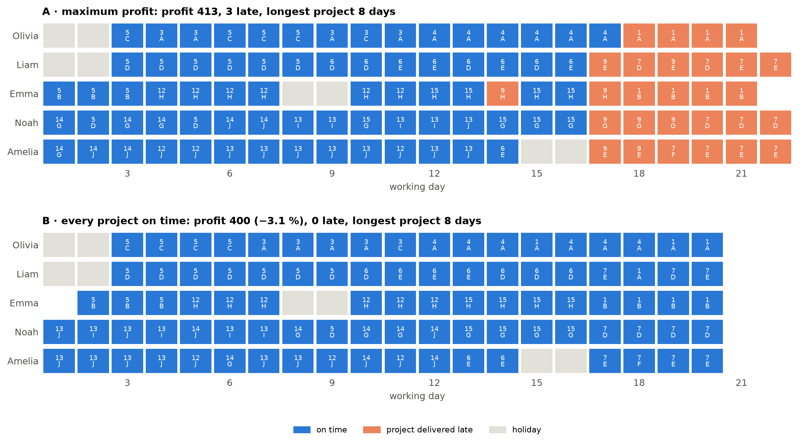
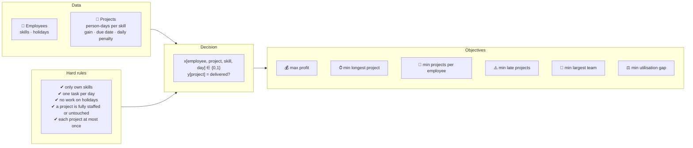
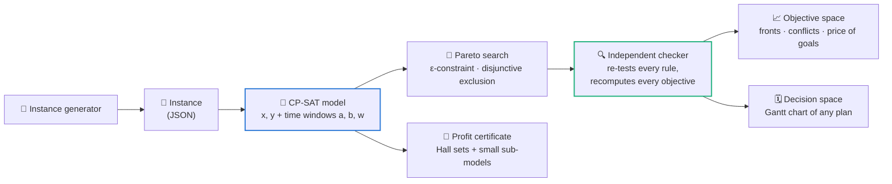
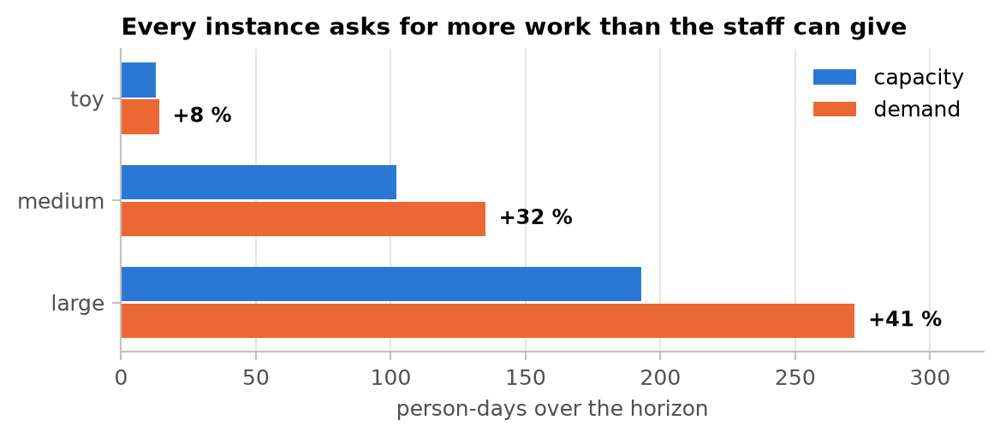
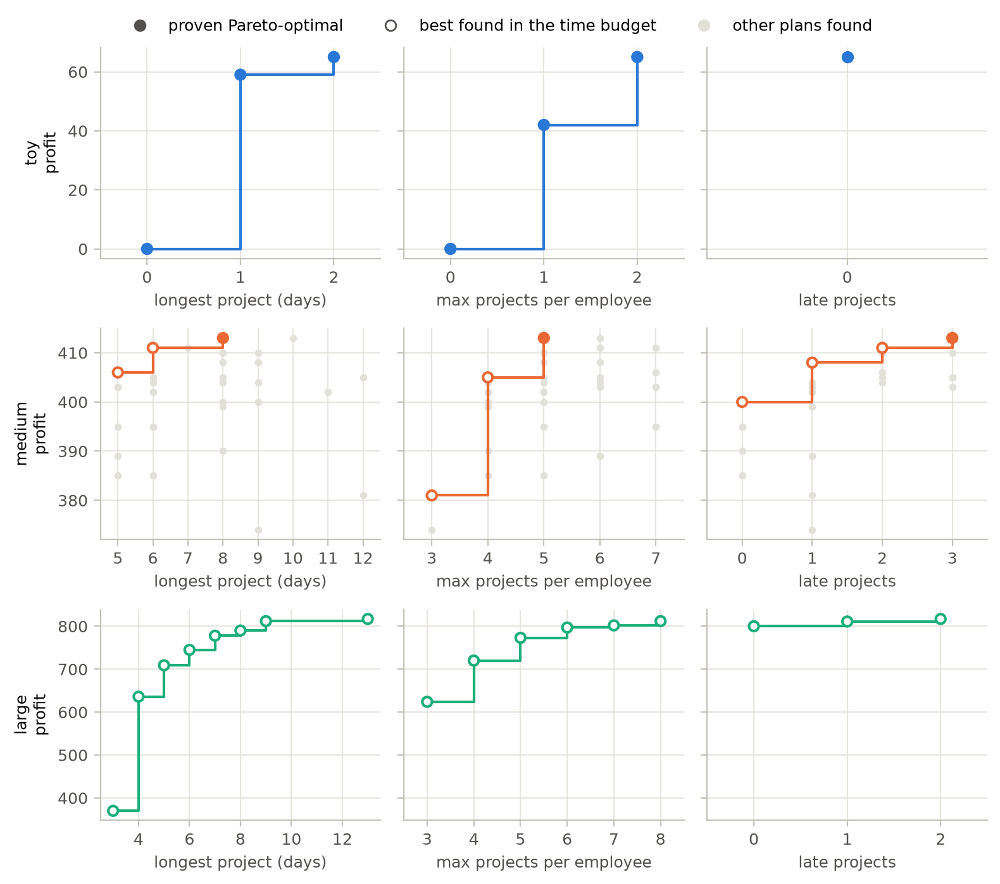
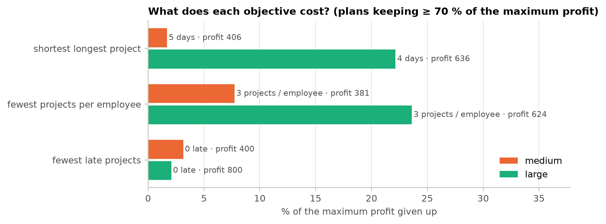
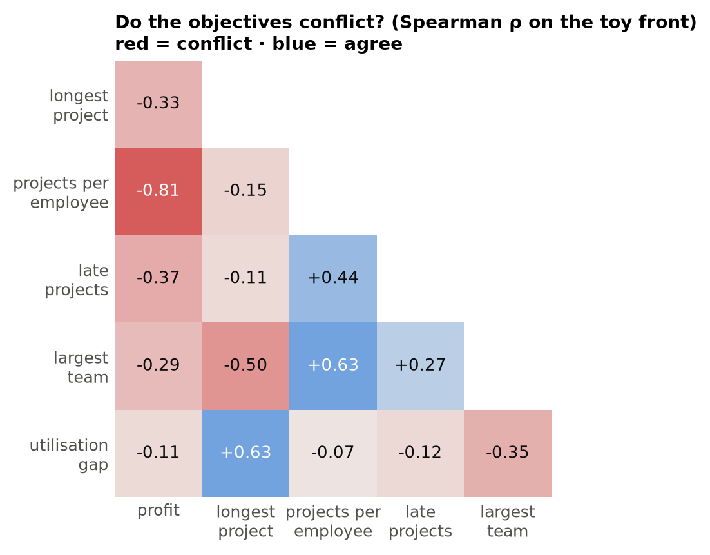
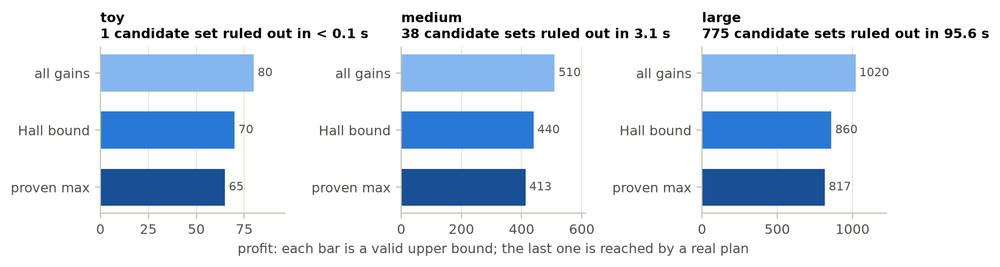
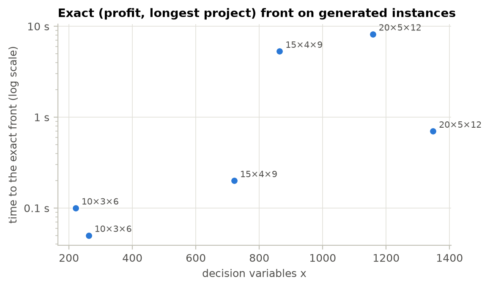

<div align="center">

# CompuOpti · multi-objective staff scheduling

**Who works on which project, with which skill, on which day, and what each trade-off costs.**

Decision Modelling project · CentraleSupélec · course by V. Mousseau


[**Notebook**](CompuOpti_staffing.ipynb) ·
[**Model & maths (PDF)**](docs/model.pdf) ·
[**Figures**](docs/figures)

</div>



> **Reading the picture.** Rows are employees, columns are working days, each cell is *project number
> / skill*. Plan **A** earns the most but delivers 3 projects late (orange). Plan **B** gives up about
> 3 % of the profit and delivers everything on time. Choosing between such plans is the decision the
> CEO faces; this project computes **all** the plans worth considering.

---

## At a glance

| | toy | medium | large |
|:--|:--:|:--:|:--:|
| Size: days × employees × projects | 5 × 3 × 5 | 22 × 5 × 15 | 36 × 6 × 25 |
| Demand ÷ capacity (person-days) | 1.08 | 1.32 | 1.41 |
| **Maximum profit** (certified) | **65** | **413** | **817** |
| Pareto front, brief's 4 objectives | **13 plans, exact** | 30 plans in 6 min (2 proven) | profit vs each objective |
| Pareto front, all 6 objectives | **18 plans, exact** | – | – |

- Every instance needs **more work than the staff can supply**, so the real decision is *which projects to accept*.
- Two independent Pareto methods return **identical fronts**, and on 20 random tiny instances the
  solver's front **equals a brute-force enumeration** of every possible schedule.
- The maximum profit is proven twice: by CP-SAT, and by an independent **Hall-theorem certificate**.
- On **our own generated instances** (saved in [`Datasets/generated/`](Datasets/generated)), every
  front is exact: 38 plans for the four objectives on a 15 × 4 × 9 instance.

---

## The problem in one picture



| | Objective | Sense | Why it matters | Source |
|:--|:--|:--:|:--|:--:|
| f1 | Profit = gains − late penalties | max | the company's income | brief |
| f2 | Longest project (calendar days) | min | client waiting time | brief |
| f3 | Most projects for one employee | min | less context switching | brief |
| f4 | Number of late projects | min | reputation | brief |
| E1 | Largest team on one project | min | coordination cost | **ours** |
| E2 | Utilisation gap, busiest vs least busy (% of available days) | min | fairness | **ours** |

---

## How it works



**The model.** Assignment variables $x_{i,j,k,t}$ exist only where they are legal (the employee
has the skill, the project needs it, the day is not a holiday), so two rules hold by construction.

$$\sum_{j,k} x_{i,j,k,t} \le 1 \quad\forall i,t \qquad\qquad \sum_{i,t} x_{i,j,k,t} = n_{j,k}\,y_j \quad\forall j,k$$

Each project gets a **time window**: $a_{j,t}$ = "started by day $t$" (switches on once), $b_{j,t}$ =
"still open on day $t$" (switches off once), $w_{j,t}=a_{j,t}\wedge b_{j,t}$. All work stays inside the
window, which makes duration and lateness **linear, with no big-M**:

$$\text{span}_j = \sum_t w_{j,t} \qquad \text{late days}_j = \sum_{t>d_j} b_{j,t} \qquad \text{late}_j = b_{j,\,d_j+1}$$

**Exact Pareto search.** Solve a profit-first weighted sum, then forbid the point just found by
requiring *"beat it strictly on at least one objective"*; repeat until infeasible. When every solve
is proven optimal, the result is exactly the set of non-dominated plans. With a time limit, the points
found are still valid and mutually non-dominated, and each one is flagged `proven` or not.

**Certified maximum profit.** By Hall's theorem, a set of projects can be staffed (ignoring due dates)
iff, for every subset of skills, demand ≤ the days of the employees holding one of them. A
depth-first search lists every staffable set that could beat the best plan, and a tiny CP-SAT model
rules out each one.

Full formulation, every equation, and the exactness proofs: **[docs/model.pdf](docs/model.pdf)**.

---

## Results

### Why projects must be refused


No single skill is overbooked on its own, but the same people hold several skills, so together
the projects ask for 8–41 % more person-days than the staff have. Some projects must be declined.

### Trade-offs in objective space


Each panel is profit against one objective. The coloured staircase is the set of plans no other plan
beats on both axes; filled dots are proven Pareto-optimal.

### What each objective costs


On both instances, **removing all late deliveries costs only 2–3 % of the profit**. Keeping every
employee on at most 3 projects is far more expensive: about 8 % on medium and over 20 % on large.

### Which objectives really conflict
<p align="center">
  
</p>

Profit conflicts most with focus (projects per employee). Of our two extras, small teams make
projects last longer, while fairness barely conflicts with profit on the exact toy front.

### Proof of the maximum profit


### Our generated instances
The generator writes the same JSON format as the given files, with demand above capacity as in the
real data; every instance below is reproducible from its seed and saved in
[`Datasets/generated/`](Datasets/generated).

| Instance (days × employees × projects) | Decision variables | Objectives | Pareto plans | Exact |
|:--|:--:|:--|:--:|:--:|
| `h15_s4_j9_q5_seed1` (15 × 4 × 9) | 682 | brief's four | **38** | ✔ |
| 6 instances, 10 × 3 × 6 to 20 × 5 × 12 | 221 – 1,348 | profit, longest project | 3 – 10 | ✔ all |



Every front is proven in under 10 s, but the time grows quickly and unevenly with size: this is why
the medium and large fronts run under a time budget.

---

## Run it

You need [uv](https://docs.astral.sh/uv/).

```bash
uv sync                                                      # ortools, pandas, matplotlib, jupyter
uv run jupyter lab CompuOpti_staffing.ipynb                  # then Run All (about 15–25 min)
```

`TL` (seconds per solve) and `BUDGET` (seconds per front) in the first code cell trade run time
against how many medium/large points are proven. The last section of the notebook draws all the
figures and re-exports the seven key ones to `docs/figures/`.

To rebuild the PDF: `cd docs && tectonic -X compile model.tex`.

## What's in the notebook

| § | Section | What you get |
|:--:|:--|:--|
| 1–2 | Data and independent checker | instance statistics; `evaluate()` re-tests every rule |
| 3 | CP-SAT model | one short cell per constraint group and objective |
| 4 | Maximum profit | optimal plans and Gantt charts |
| 4b | Profit certificate | Hall-theorem proof that the maximum is optimal |
| 5–6 | Pareto methods, toy | exact fronts (4 and 6 objectives), both methods compared, slider over plans |
| 7–8 | Medium and large | fronts under a time budget, payoff tables |
| 9 | Instance generator | same JSON format; exact fronts on our instances, saved to `Datasets/generated/`; scaling test |
| 10 | Brute-force verification | solver front = enumeration on 20 / 20 cases |
| 11 | Conclusions | |
| 12 | Figures | the presentation figures in this README |

## Repository

```text
.
├── CompuOpti_staffing.ipynb                the whole project: model, Pareto search, proof, plots, generator
├── docs/
│   ├── model.pdf / model.tex               model, equations and proofs (LaTeX)
│   └── figures/                            figures exported by the notebook (PNG + vector PDF)
├── reference_model/                        course reference MILP: notation, variables, full model
├── Datasets/                               toy, medium and large instances (given)
│   └── generated/                          our instances from the generator (JSON, same format)
├── Projet_MScAI_2026_27-3.pdf              project brief (given)
├── TP0-Corrigé.ipynb                       course tutorial (given)
└── pyproject.toml, uv.lock                 Python dependencies
```
