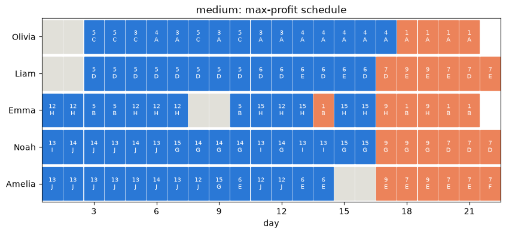
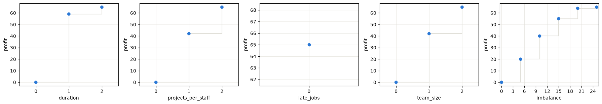
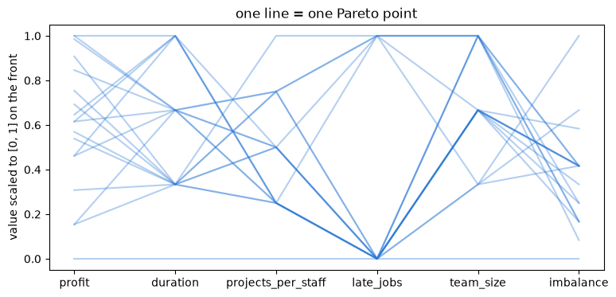
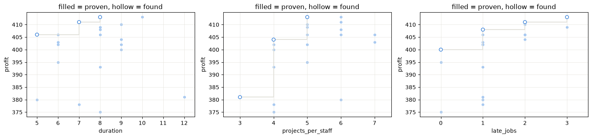
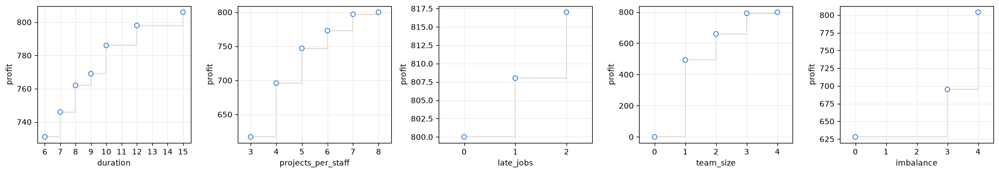
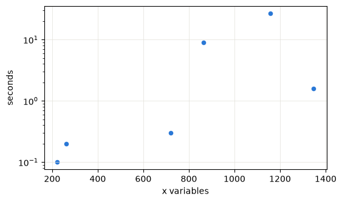

# CompuOpti staffing: project report

Decision Modelling project, CentraleSupélec. Brief: `01_project_brief/Project_Brief_Staffing_CompuOpti.pdf`.
All code and results are in [`CompuOpti_staffing.ipynb`](../CompuOpti_staffing.ipynb). This report
explains what we built, why, and what the results mean.

---

## 1. The problem

CompuOpti has a team of employees, each with some qualifications (A, B, C, …) and some holiday days,
and a list of candidate projects. Each project needs a given number of person-days per qualification
(for example 3 days of A and 2 of B). It brings a gain if delivered, and it has a due date with a
daily penalty for every day it is late. Over a horizon of *h* working days, the company must decide
**who works on which project, with which skill, on which day**.

The brief asks for:

1. A model that satisfies the hard rules:
   - an employee only uses a skill they have;
   - one task per employee per day;
   - nobody works on holiday;
   - a project counts as done only if every required person-day is covered;
   - each project is done at most once.
2. Four objectives:
   - maximise **profit** (gains minus late penalties);
   - minimise the **longest project duration**;
   - minimise the **number of projects per employee**;
   - minimise the **number of late projects**.
3. The **full set of non-dominated (Pareto-optimal) solutions**.
4. Visualisations in **objective space** (trade-offs) and **decision space** (the schedules).
5. An **instance generator**.

## 2. Reading the brief as a real staffing problem

Some choices are not fixed by the brief. We made each one the way a real company would, and they
shape the model:

| Question | Our choice | Why |
|---|---|---|
| Can a rejected project receive some work? | **No.** Coverage is an equality: a project is fully staffed or untouched. | Nobody half-staffs a project they won't deliver. (The reference model uses ≤. Partial work on a dropped project earns nothing, so the max profit is the same either way; the equality just forbids useless work.) |
| What is a project's "duration"? | **Calendar span**, from first to last working day, holiday gaps included. | That is the waiting time the client experiences. |
| Which projects can be late? | **Only delivered ones.** A dropped project counts as declined, not late. | Lateness is a promise broken to a client who signed. |
| Duration and projects-per-employee: total, average or max? | **Max** (worst project / most-loaded employee). | One very long project or one overloaded person is what hurts. This was the team's decision. |
| What about "do nothing"? | It is always Pareto-optimal, because every minimised objective improves by doing less. | We show a **reservation profit** (70 % of max) in the payoff tables, so the trivial region is visible but separate. |

All three instances need more person-days than the staff can supply (demand/capacity 1.08, 1.32 and
1.41). The core decision is therefore **which projects to accept**, not only how to schedule them.

| Instance | days | staff | jobs | decision variables x | demand / capacity |
|---|---|---|---|---|---|
| toy | 5 | 3 | 5 | 90 | 1.08 |
| medium | 22 | 5 | 15 | 1,298 | 1.32 |
| large | 36 | 6 | 25 | 3,939 | 1.41 |

## 3. Two extra objectives

The brief allowed us to propose extra objectives. We added two, each tied to a real cost:

| | Objective | Real-world meaning | Expected conflict |
|---|---|---|---|
| **E1** | **Largest team** on any project (min) | Coordination cost: more people means more meetings and hand-overs | Small teams make projects last longer (conflicts with duration) |
| **E2** | **Utilisation gap** (min): most-loaded minus least-loaded employee, in % of *available* days | Fairness. Measured in % so that holidays don't count as idleness. Only staff who could work on some project are counted. | Fair plans may cost profit |

What we found (section 7): E1 is a real, strong trade-off. E2 conflicts with team size but **costs
almost no profit**. Because the instances are over capacity, at max profit almost everyone is
already busy. That is a finding in itself: on this data, fairness is nearly free.

## 4. The model (OR-Tools CP-SAT)

### Why CP-SAT and not Gurobi

The course reference model is a Gurobi MILP. We use **Google OR-Tools CP-SAT** because:

- it is free, with no licence size limits;
- the problem is almost entirely 0/1 decisions, which CP-SAT handles very well;
- it runs many search strategies in parallel and proves optimality.

### Sets and data

* Days $t \in \{1..h\}$. Employees $i$ with qualifications $Q_i$ and holidays $V_i$. Jobs $j$ with
  gain $g_j$, due date $d_j$, daily penalty $c_j$, and need $n_{j,k}$ person-days of qualification $k$.

### Decision variables

* $x_{i,j,k,t}\in\{0,1\}$: employee $i$ works on qualification $k$ of job $j$ on day $t$. It is
  **only created when it is legal** ($k\in Q_i$, $j$ needs $k$, $t\notin V_i$). The skill and
  holiday rules therefore hold by construction, and the model stays small (3,939 variables on large).
* $y_j\in\{0,1\}$: job $j$ is delivered.
* For each job, three day-indexed booleans:
  - $a_{j,t}$: "has started by day $t$";
  - $b_{j,t}$: "is still open on day $t$";
  - $w_{j,t} = a_{j,t}\wedge b_{j,t}$: "day $t$ is inside the job's window".

### Hard constraints

$$\sum_{j,k} x_{i,j,k,t} \le 1 \quad \forall i,t \qquad\text{(one task per day)}$$

$$\sum_{i,t} x_{i,j,k,t} = n_{j,k}\, y_j \quad \forall j,k \qquad\text{(all or nothing, at most once)}$$

$$a_{j,t}\le a_{j,t+1},\quad b_{j,t+1}\le b_{j,t},\quad \sum_k x_{i,j,k,t} \le w_{j,t},\quad w_{j,t}\le y_j$$

The window is one unbroken stretch, and all work on a job happens inside it. So:

* span of job $j$ $= \sum_t w_{j,t}$;
* late days of $j$ $= \sum_{t>d_j} b_{j,t}$;
* $j$ is late iff $b_{j,d_j+1} = 1$.

This "time-indexed window" formulation has no big-M constants. An earlier start/end-day version
was much slower to prove optimality.

Two **valid cuts** speed up the solver without removing any solution:

* the total demand per qualification ≤ the available days of its holders;
* a job's span ≥ its busiest qualification's need ÷ the number of holders.

### Objectives

| | Definition | Linking |
|---|---|---|
| f1 profit | $\sum_j g_j y_j - \sum_j c_j \cdot \text{late days}_j$ | equality |
| f2 duration | $v \ge \sum_t w_{j,t}\ \forall j$ | $v \ge$ every span |
| f3 projects per employee | $u_{i,j} \ge x_{i,j,k,t}$; $v \ge \sum_j u_{i,j}\ \forall i$ | $v \ge$ every count |
| f4 late jobs | $v = \sum_j b_{j,d_j+1}$ | equality |
| E1 team size | $v \ge \sum_i u_{i,j}\ \forall j$ | $v \ge$ every team |
| E2 utilisation gap | $\text{util}_i = \lfloor 100\cdot\text{load}_i/\text{avail}_i\rfloor$; $v = \max - \min$ | $v \ge$ true gap |

Derived quantities are linked **in one direction only**. This is enough, because the true values
are always a feasible choice for $v$, so optimising, bounding or excluding $v$ stays exact. The
catch is that an objective that is *not* being optimised may come back overstated. We therefore
**never report solver values**: every schedule is re-checked by an independent `evaluate()`
function, which tests every hard rule and recomputes all six objectives from the raw assignments.

## 5. Computing the Pareto front

### Method 1: ε-constraint (two objectives, textbook)

Maximise profit subject to $f \le \varepsilon$, record the point, set $\varepsilon = f - 1$, and
repeat until infeasible. To avoid weakly dominated points, the objective is augmented:
$R\cdot\text{profit} - f$ with $R = 1 + \text{range}(f)$. The second objective then breaks ties but
can never outweigh one unit of profit.

### Method 2: disjunctive exclusion (any number of objectives)

1. Minimise the strictly positive weighted sum
   $-R\cdot\text{profit} + \sum_{k\ne\text{profit}} f_k$.
2. After finding point $p$, add the constraint "**beat $p$ strictly on at least one objective**":
   $\bigvee_k (f_k \text{ strictly better than } p_k)$.
3. Repeat until the model is infeasible.

**Why it is exact.**

* *Each point is Pareto-optimal.* If a solve is optimal, its point is Pareto-optimal: anything that
  dominated it would also satisfy every exclusion and have a smaller weighted sum.
* *Nothing is missed.* When the model becomes infeasible, no Pareto point can be missing, because
  any such point would satisfy all the exclusions.

So when every solve is proven optimal and the search ends infeasible, the front is **exactly the
full non-dominated set**. The notebook reports this as `exact = True`.

### Time budgets

The search has a time limit per solve (`TL`) and per front (`BUDGET`). If either runs out, the
result is still a set of **valid, mutually non-dominated schedules**. Each point carries a `proven`
flag, true when its solve was proven optimal and the point is therefore guaranteed Pareto-optimal.

## 6. Verification

| Check | Result |
|---|---|
| Max profit proven optimal by CP-SAT | 65 / 413 / 817 (toy / medium / large) |
| ε-constraint vs disjunctive on the toy, every pair (profit, X) | identical fronts |
| Solver front vs **brute force** (every possible schedule listed) on tiny generated instances, 4 and 6 objectives | **20 / 20** identical |
| Every reported schedule re-checked by the independent `evaluate()` | all feasible |

## 7. Results

### 7.1 Maximum profit (one objective)

| | toy | medium | large |
|---|---|---|---|
| Max profit, proven optimal | **65** | **413** | **817** |
| Late projects in that plan | 0 | 3 | 2 |

Even the most profitable plan delivers some projects late on medium and large. Being late on a
lucrative project can be worth more than dropping it.



*Rows are employees and columns are days. Each cell shows the job number and qualification. Orange
marks work on a project that ends late; grey marks holidays.*

### 7.2 Toy instance: solved exactly

The brief's four objectives give **13 Pareto-optimal plans**, all proven, with both methods
agreeing:

| profit | duration | projects/employee | late jobs |
|---|---|---|---|
| 65 | 2 | 3 | 0 |
| 65 | 3 | 2 | 0 |
| 59 | 1 | 4 | 1 |
| 55 | 2 | 2 | 0 |
| 49 | 1 | 3 | 1 |
| 45 | 1 | 3 | 0 |
| 42 | 3 | 1 | 1 |
| 40 | 3 | 1 | 0 |
| 37 | 1 | 2 | 1 |
| 35 | 1 | 2 | 0 |
| 30 | 2 | 1 | 0 |
| 20 | 1 | 1 | 0 |
| 0 | 0 | 0 | 0 |

Reading it as a manager:

* The two plans with profit 65 differ only in the trade-off between duration and focus (2 days and
  3 projects/employee vs 3 days and 2 projects/employee).
* Making every project last a single day costs 6 profit (59) plus one late project.
* Giving every employee a single project costs 23 profit (42).

With all six objectives the exact front has **18 points**.



*Profit against each other objective (exact two-objective fronts). Each step is a trade-off:
moving right gives up some of that objective to gain profit.*

**Do the objectives really conflict?** Spearman correlation over the 18 points, every objective
oriented "smaller is better" (negative = conflict):

| | profit | duration | proj./employee | late | team size | fairness gap |
|---|---|---|---|---|---|---|
| profit | 1 | −0.33 | **−0.81** | −0.37 | −0.29 | −0.11 |
| team size | −0.29 | **−0.50** | 0.63 | 0.27 | 1 | −0.35 |
| fairness gap | −0.11 | 0.63 | −0.07 | −0.12 | −0.35 | 1 |

* Profit conflicts most with focus (projects per employee).
* Team size conflicts with duration: smaller teams take longer.
* Fairness conflicts with team size, but barely with profit.



### 7.3 Medium instance: four objectives

The search runs for 6 minutes (10 s per solve). It finds **about 20–30 mutually non-dominated
plans**; the exact count varies a little between runs. Few or none are proven: proving optimality
takes much longer than finding the plans.

The payoff table, restricted to plans earning at least 70 % of the max profit, gives the decisions
a manager can actually choose between:

| Best plan for… | profit | duration | projects/employee | late |
|---|---|---|---|---|
| profit | 413 | ~8–10 | ~5–6 | 3 |
| duration | ~406 | ~5–6 | ~6–7 | 2 |
| projects per employee | ~380 | 12 | **3** | ~1–2 |
| late projects | ~400 | ~8–9 | ~4–5 | **0** |

*(Ranges cover our runs. The notebook shows the exact table for the run you execute.)*

**Main message:** giving up about **3 % of profit removes all late deliveries**. Limiting every
employee to 3 projects costs about **8 %**.



*Faint dots are all plans found. Blue circles form the staircase of plans that are non-dominated
in that two-objective view.*

### 7.4 Large instance: profit against each objective

Two-objective fronts, 2 minutes each. The pattern matches medium:

* duration and focus can be improved at a moderate profit cost;
* lateness can be removed for about 2 % of profit (≈ 800 vs 817);
* fairness is the least stable pair: with 2 minutes, the best fully fair plan found ranged from 628 to 807 across our runs. A 1-hour run during development proved the exact front is just two plans, (817, gap 4 %) and (812, gap 0 %): perfect fairness costs under 1 % of profit.

With a 2-minute budget, some runs do not even reach the 817 maximum on these fronts. That is a clear sign of how much harder the proof is than finding a good plan.

These points are not proven within the budget.



### 7.5 Generator and scaling

The generator writes instances in the same JSON format as the given files:

* gains grow with workload and urgency;
* each employee gets one holiday block;
* a `load` parameter sets demand/capacity, and the generator redraws until demand exceeds capacity,
  as in the real data.

Scaling test, profit vs longest project, two seeds per size:

| days × staff × jobs | x variables | Pareto points | exact | seconds |
|---|---|---|---|---|
| 10 × 3 × 6 | 220–260 | 3–4 | yes | 0.1 |
| 15 × 4 × 9 | 720–860 | 5–6 | yes | 0.2–9 |
| 20 × 5 × 12 | 1,150–1,350 | 7–10 | yes | 1–22 |

Every generated two-objective front up to about 1,400 variables is proven exact within seconds.
The time grows quickly and unevenly with size, which is why the large instance with four
objectives cannot be proven within a practical time.



## 8. How a decision-maker would use this

1. **Set a reservation profit** (here 70 % of the maximum) to cut the trivial "do little" region.
2. **Read the payoff table.** For each objective, it shows the best plan for that objective and
   what that plan costs on the others. On medium, it shows that removing all lateness costs about
   3 % of profit.
3. **Browse the front.** The parallel-coordinates plot and the slider let you scroll through
   Pareto points and see the actual schedule (Gantt chart) behind each one.
4. **Pick a point, then check it in decision space**: who works on what, which projects are
   declined, and which are late.

## 9. Limitations and next steps

* **Proof is the bottleneck.** Finding good schedules takes seconds. Proving there is no better one
  takes hours on medium/large with three or more objectives. Our medium/large fronts with several
  objectives are therefore good, valid approximations, with the proven points marked.
* A faster exact method would need decomposition (for example, choose the projects first, then
  schedule them) or a stronger LP-based solver for the proof step.
* The generator is calibrated on the three given files only (gain ≈ workload + urgency, one holiday
  block per person). Real data might have very different skill structures.

## 10. Reproduce

```bash
uv sync                                  # installs ortools, pandas, matplotlib, jupyter
uv run jupyter lab CompuOpti_staffing.ipynb   # then Run All (~15 min)
```

Change `TL` / `BUDGET` in the first code cell to trade run time against how many points are proven.
